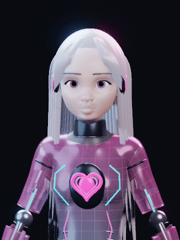

# Kokoro — controller-connected body

**[Watch the MP4 with browser playback controls](https://ripple-neuron-phone.floot.app/_cdn/static/kokoro-controller-connected-20261102.mp4)**

This is a recording of **30 freshly computed controller states**, not playback of the model's saved animation Action. Kokoro's existing virtual controller supplies actual head/right-arm/right-forearm positions to a persistent local Blender process. The head turns, the arm lifts, the command reverses, and the body returns toward neutral. The overlay shows requested and actual head angles. The two blinks and jaw pulse are explicitly supplied manual test inputs, not autonomous emotion or speech.

## What now works in the updated test studio

The existing desktop has an opt-in **Native rig** tab. Its ordinary movement commands and Single step/Start controls drive the new body. Face and external-camera settings save/load and survive Restart. Loading a project does not launch an executable. Disconnects and failed native steps clear the old picture instead of presenting a frozen pose as live.

Fresh checks: **65/65 application tests**, **30/30 native deformation/restore checks**, **8 actual GUI-to-Blender checks**, plus 30 actual connected frames. A deliberately wrong head-axis adapter failed the directional-motion checks. The original Ripple and VTK sensor calculations matched the untouched studio in a separate 12-frame comparison.

**Performance and scope:** the six-second simulated sequence took about 171.3 seconds to compute on the CPU test environment; this is not a real-time performance claim. The native body's first-person pixels are **not yet** feeding the original VTK optical-feedback experiment. Native eye origins/directions are returned separately in model coordinates. Physical hardware, Windows compatibility, generalized vision, whole-body control and final artistic likeness are not claimed.

No project download is needed to review the motion. The native .blend is reused, not duplicated in every update.

Source, reproducibility and preservation

[Updated studio source and tests — 4.3 MB](https://ripple-neuron-phone.floot.app/_cdn/static/c9262acc-d903-4392-9b61-1abb5e991499-Kokoro_Controller_Rig_Integration_v0_1.zip)

Source ZIP SHA-256: `496b19e6dd8739b4463ed5b1a55f9217994121bf4b1ae740b0a0b0c9d183d6f8`.

[Raw test logs, controller trace, saved PNGs and negative controls — 6.2 MB](https://ripple-neuron-phone.floot.app/_cdn/static/Kokoro_Controller_Rig_Evidence_20261102.zip)

Evidence ZIP SHA-256: `150ce9f6b2c46416a3ad342c2019807a85253712b6fd87c65db48f96e34bf5d0`.

Native source .blend SHA-256: `be9cb6b2575334ff912f45a9ff226a552f7216d2b1d7707ba830f8867690ce93`.

Use the existing Kokoro v0.3 native file with the new studio's Native rig tab. Executed with Blender 3.4.1 on Linux. Fresh source extraction repeated all 65 application tests and verified 186 content hashes. Original upstream/Ripple source directories and native-model bytes remain unchanged. The original release archives are preserved. This review update does not merge into master or alter a production application.

Earlier saved-action rig check (historical, not controller-connected)

The earlier five-second loop exercised the saved model Action. It is retained here as historical rig evidence, distinct from the new controller-driven recording above.

Rain Rig (CC) Blender Foundation | studio.blender.org — CC BY 4.0; modified as Kokoro.
