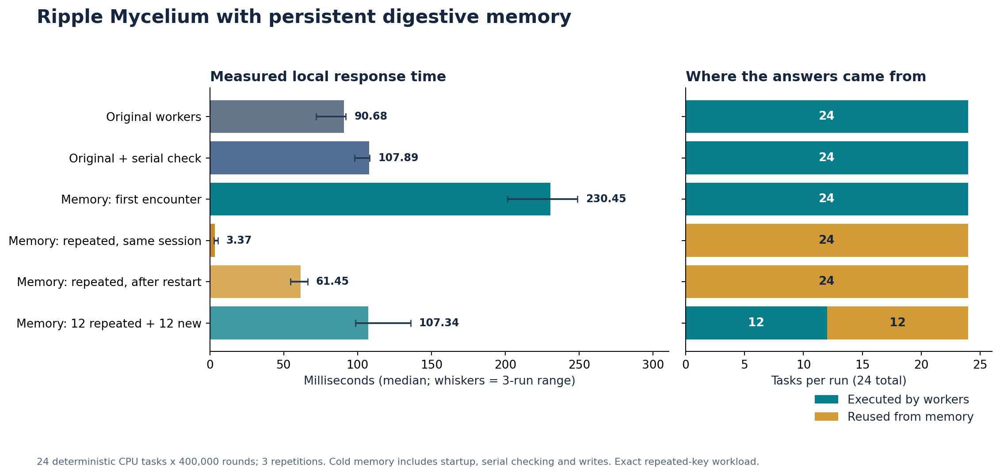

# Ripple Mycelium + Digestive Memory v0.1

Ripple's original worker colony now has a persistent memory adapter. It can reuse exact, previously checked work across restarts, store dated observations with their sources, preserve conflicts, retrieve bounded context and honor source deletion.

The original scheduler, neuron equations and specialist mathematics are preserved byte-for-byte. The new code wraps the real v0.2 Node worker-thread colony and connects the existing Python Digestive Memory engine through a private local pipe. It does not replace the colony with renamed ordinary functions.

## What improves

| Before | With the adapter |
|---|---|
| Completed job results were held in one colony instance | Exact checked results persist in SQLite and can be reused after restart |
| Repeating the same task created worker work again | A matching valid memory record can answer without starting workers |
| No general dated observation memory in this scheduler | Structured observations retain sources, effective dates and explicit conflicts |
| No durable task-memory erasure | Deleted exact task identities stay revoked and cannot silently recache |
| Worker completion alone was the task result | New results are serial-parity checked before absorption |

## Run

Node 20+ and Python 3.10+. No third-party runtime package installation is required. Actual tests were run on Linux with the versions recorded in evidence/benchmark.json.

```bash
npm test
npm run demo
npm run benchmark
```

`npm test` verifies 60 original source hashes, regenerates the original omitted synthetic sweep fixture, and runs every included suite: 17 original real-worker tests, 24 original specialist tests, 41 original memory tests, 17 integration tests and 1 multi-process accounting test. **100 tests total passed.**

The demo runs fresh work, repeats it, closes the process and retrieves the results after reopening the same database. Its location observations are synthetic examples. Pass a database path with `node scripts/demo.js ./memory.sqlite` to retain that demo database; otherwise the demo uses and removes a temporary directory.

## Use the real colony through the adapter

```javascript
const {MemoryMycelium}=require('./src/memory_mycelium');

(async()=>{
  const colony=await MemoryMycelium.open({
    dbPath:'./memory.sqlite',
    scope:{tenant:'local',owner:'me',project:'my-research'}
  });
  try {
    const tasks=[{id:1,rounds:400000},{id:2,rounds:400000}];
    console.log((await colony.runBatch(tasks)).telemetry); // fresh work or remembered results
    console.log((await colony.runBatch(tasks)).telemetry); // exact repeated work
    await colony.remember({sourceId:'experiment-1',subject:'bench-A',
      predicate:'condition',value:'dry',observedAt:Math.floor(Date.now()/1000)});
    console.log(await colony.recall('bench-A','condition'));
  } finally {
    await colony.close();
  }
})().catch(error=>{console.error(error);process.exitCode=1;});
```

The current worker payload remains the original deterministic integer kernel (`id`, `rounds`). Structured observations can describe other experiments, but this release does not dispatch arbitrary scientific models or extract facts from unrestricted conversation.

## Measured comparison



Same 24 tasks x 400,000 integer rounds, three repetitions per mode, four-worker elastic Ripple configuration. Every returned value matched serial computation. Raw measurements: [JSON](evidence/benchmark.json), [CSV](evidence/benchmark.csv).

| Mode | Median ms | Three-run range ms | Worker jobs/run | Memory hits/run |
|---|---:|---:|---:|---:|
| Original workers | 90.68 | 72.08-92.05 | 24 | 0 |
| Original + serial check | 107.89 | 97.86-108.19 | 24 | 0 |
| Memory: first encounter | 230.45 | 201.68-248.70 | 24 | 0 |
| Memory: repeated, same session | 3.37 | 2.91-5.41 | 0 | 24 |
| Memory: repeated, after restart | 61.45 | 54.58-66.14 | 0 | 24 |
| Memory: 12 repeated + 12 new | 107.34 | 98.62-135.85 | 12 | 12 |

These timings show an exact repeated-work benefit and a cold-path cost. First-encounter memory work includes bridge startup, original worker execution/shutdown, serial checking and persistent writes. Repeated same-session work excludes bridge startup; the restart row includes startup. Memory subprocess shutdown is outside those memory phases. Original rows include worker startup/shutdown; the second baseline also includes serial checking.

Cold and partly new work need not be faster. Do not apply the warm-cache ratio to new questions, model inference, energy use or unrelated workloads. Lookup currently scans the scoped cache history; use an indexed adapter before very large histories. Three repetitions on a shared runtime are not a deployment SLO.

## Memory rules that matter

- Keys bind exact inputs, schema and source fingerprint. Changed parameters or code get a different identity.
- The master checks all new worker outputs before storing any result from that batch.
- Result records and ordinary observations use structurally disjoint derived namespaces; user observations cannot become verified cache results.
- External and low-confidence observations remain quarantined under the inherited policy.
- Dates and evidence receipt cutoffs are separate. Equal-priority conflicting values remain conflicts.
- Deleting a source invalidates its dependent digests. Deleting an exact task key prevents silent re-absorption; later requests can still calculate it afresh.
- Source/digest checks detect recorded integrity problems; the local database remains controlled by the host. Hashes are not protection against an owner forging both content and hashes.

## Files and evidence

| Path | Purpose |
|---|---|
| src/memory_mycelium.js | Original worker-colony wrapper and verified reuse |
| src/memory_bridge.js | Bounded private-pipe lifecycle and protocol validation |
| python/memory_service.py | Typed adapter over the unchanged memory engine |
| vendor/mycelium-v02/ | Preserved original real scheduler and tests |
| vendor/mycelium-v03/ | Preserved specialist math and tests |
| vendor/digestive-memory/ | Existing memory runtime and its original 41 tests |
| SOURCE_PROVENANCE.json / VENDOR_INTEGRITY.json | Repository/archive lineage and 60 exact source hashes |
| test/ | New integration, corruption, namespace, protocol and concurrency tests |
| docs/API.md | Exact API, resource bounds and lifecycle semantics |
| docs/DESIGN.md / PLAN.md | Design choices and completed implementation sequence |
| docs/REVIEW.md | Independent review findings and regression fixes |
| evidence/ | Raw measurements, demo, red/green regressions and verification |

The repository source baseline is `78fd9d3289b7ce9c82d25caf6679d8a4aa42c2ce`. Historical vendor folders are source-only capsule restorations, not a claim to include every old binary, dataset or asset. Original source licenses are retained. No external inference service, miner, credentials or physical hardware was used by this integration.
