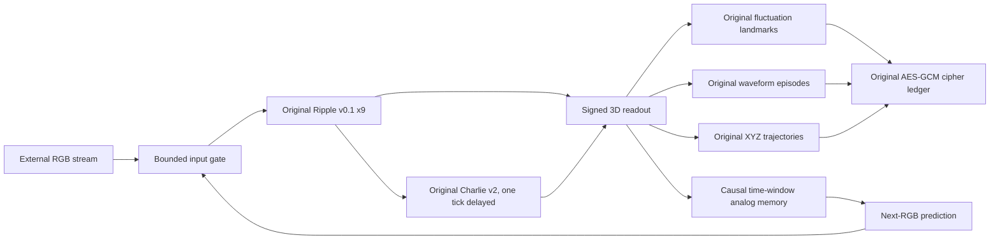
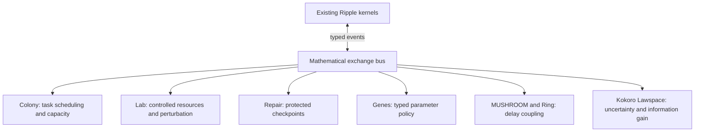

# Ripple Mathematical Integration — Architecture Decision Record 001

**Version:** v1.0 research implementation · **date:** 2026-10-20 · **Parent:** Ripple XYZ Cross-Channel Memory v0.2 (unmodified) · **Branch objective:** executable mathematical interoperability without substituting an LLM or generic neuron.

## Recommended architecture: typed multi-rate causal state-space compartments

The design model is a collection of **different mathematical operators sharing a causal event ledger**, not a universal RGB-to-weight matrix and not a single biological metaphor.

### Base operational graph (implemented now)

The real implementation additionally indexes the original stored XYZ episode coordinates paired with each following original RGB sample. During live computation the search only sees already-processed model states and **training completed before live computation**.

The feedback edge is disabled until it finds a sufficiently close source trajectory **in both fluctuation and invertible color state spaces**, with enough temporal motion to be distinguishable. Its coefficient is bounded in [0,0.5]. The external input is retained and reported separately from the effective input. A source trace match is a retrieval of known synthetic history, not proof of understanding.

### Next-stage graph (not present in runtime)

These remain future connectors. Their mathematics is independently documented and in several cases separately executed in prior releases, but this new runtime does not pretend to import or continuously operate them.

## Contracts

| Contract | Inputs | Persistent state | Outputs | Invariants / failure modes |
|---|---|---|---|---|
| RGB sensor proxy | 3 finite sRGB scalars in [0,1] | none | timestamped encoded RGB | Synthetic fixture ≠ optical camera measurement |
| Preserved Ripple | legal three-slot virtual RGB controls, model dt | membrane, threshold, refractory and rate | spike events, membrane, signed features | Original source hashes, dt <= 0.5 model s |
| Charlie v2 | delayed signed signals mapped into exc/inh slots | conductance, adaptation, threshold | u, exc, inh, spikes | 1-tick causal delay, saturation warnings from prior source |
| XYZ reference | 3 simultaneous Ripple derived scalars; model time | per-run coordinate buffer | finite real-valued xyz points and oriented geometry | Axis convention never silently changes; model-time not physical space |
| Analog memory | 6 consecutive vectors, historical next RGB | bounded indexed training samples | prediction, nearest distance, source ID | Cannot train after live first step; no future live peeking |
| Feedback gate | external RGB, predicted RGB, confidence distance | feedback step count | effective RGB into unchanged Ripple | alpha in [0,.5]; no match or insufficient trajectory motion means alpha=0 |
| Encrypted archive | sequence of genuine recorded training entries | scrypt-derived key and ciphertext ledger | authenticated export and import | Requires passphrase; encryption is not created by fluctuations |

## Mathematics of the working control loop

Let $\mathbf c_k\in[0,1]^3$ be the incoming externally supplied normalized sRGB triplet. Its RGB values are not physical light measurements. Let $\mathbf z_k=(z_k^{(t)},z_k^{(rg)},z_k^{(bg)})\in\mathbb R^3$ be the **actual** signed readouts of the preserved Ripple RGB Mathematics implementation.

A length-$m$ history $H_k=[\mathbf z_{k-m},\ldots,\mathbf z_{k-1}]$ is constructed before processing $\mathbf c_k$. A historical entry $h^{(j)}$ from an archived XYZ episode is paired with the recorded RGB sample $\mathbf c_{j+1}^{\text{recorded}}$ immediately following the source history. For each candidate $j$:

$$d_j=\sqrt{\frac{1}{3m}\sum_{t=1}^{m}\|H_k[t]-h^{(j)}[t]\|_2^2}
+\frac14\sqrt{\frac{1}{3(m-1)}\sum_{t=2}^{m}\|\Delta H_k[t]-\Delta h^{(j)}[t]\|_2^2}.$$

This deliberately adds geometric magnitude and **time-ordered vector fluctuation**. Axis timing is joint; separately warping each axis would discard simultaneous relationships. The coefficient 1/4 is an engineering parameter in this release, not a physically discovered constant. We do not call this a new biological law.

Before accepting a candidate, compute a second compatible distance $d_j^{(c)}$ on the **invertible** linear-sRGB coordinates $(Y,R-G,B-(R+G)/2)$ of the corresponding six historical inputs, and compute the query's motion-energy $q=\sqrt{\sum_{t=2}^{m}\|H[t]-H[t-1]\|_2^2/[3(m-1)]}$. The implemented acceptance conditions are $d_j\le\tau$, $d_j^{(c)}\le 0.12$, and $q\ge 0.008$; the historical candidate must also have motion-energy at least 0.008. These are dimensionless, empirical engineering thresholds (not calibrated probabilities). They were added after an earlier cross-fixture test revealed spurious matches in stationary signals. Select at most the three nearest **qualified** entries (default $\tau=0.07$). Their recorded continuations are combined:

$$\widehat{\mathbf c}_k=\frac{\sum_j w_j\,\mathbf c_{j+1}^{\text{recorded}}}{\sum_j w_j},\quad w_j=\frac1{\max(d_j,10^{-5})}.$$

The bounded gate then supplies the actual original Ripple model input:

$$\widetilde{\mathbf c}_k=(1-\alpha_k)\mathbf c_k+\alpha_k\widehat{\mathbf c}_k,\qquad
\alpha_k=\begin{cases}\alpha\in[0,0.5]&\min d_j\le\tau\\0&\text{otherwise.}\end{cases}$$

The frozen inherited neuron computes $\mathbf x_{k+1}=F_{\rm Ripple}(\mathbf x_k,\widetilde{\mathbf c}_k)$, and the frozen Charlie computes its separately delayed conductance response. This makes the memory output a real actuator of the next state transition. The external RGB and effective RGB are always retained separately in the step record.

## Prediction, source proof and negative controls

- Equal historical continuations cause **zero input perturbation even with alpha>0**, an expected null result rather than a disconnected component.
- A deliberate divergent next input after an identical preceding history causes a bounded change in effective RGB and then the actual Ripple and Charlie state.
- Shuffled recorded continuations break the source's trajectory-to-next-input relationship, testing whether the archive contains genuine temporal structure.
- Training prior to any live step prevents use of future runtime measurements for the current prediction. The training fixture itself is deterministic and repeats, so good predictive performance on the same fixture is not a generalization claim.
- Constant gray should often yield no nontrivial correction because the recorded continuation equals the current input.
- All source kernels can be copied byte for byte and checked against their historical SHA-256; memory math must not silently mutate their constants.

## Alternative designs considered

1. **Single scalar RGB drive:** useful as historical locked baseline; provably many-to-one; insufficient as the sole color-memory coordinate.
2. **Conventional learned ANN/transformer:** could be useful in a different research project, but would displace the fluctuating canonical Ripple dynamics and obscure mechanism attribution; rejected as architecture foundation.
3. **Independent per-channel DTW:** misses cross-channel temporal coincidence. Retained in original XYZ code as comparative analysis, not selected for prediction.
4. **Unbounded resonant feedback:** can create saturation and instability, especially when a retrieved memory keeps retriggering. Rejected in favor of bounded convex RGB mixing and distance gate.
5. **Memory output as UI-only tag:** mathematically decorative. Rejected by testing direct effects on inherited neuron states.
6. **Encrypt using a waveform-derived key:** weak and unpredictable security properties with correlated, potentially observable inputs. Rejected; use inherited AES-256-GCM with passphrase-derived independent key material.
7. **Physical XYZ interpretation:** signal XYZ coordinates have no physical length units and cannot be passed to a 3D motor or optics program without a calibrated coordinate transform.
8. **All-archives simultaneous merge:** mathematical time scales, units, source languages, release conditions and valid inputs differ. An indiscriminate merge would lose auditability. Typed staged adapters are chosen instead.

## Named implementation boundaries

- **Input units:** normalized sRGB display-encoded values, not calibrated spectral counts.
- **Timing:** $\Delta t=0.05$ model seconds as inherited; wall-clock execution may be faster/slower.
- **Memory dimension:** three signed fluctuation features; these are not anatomical axes.
- **Learning:** recorded-history nearest analog with fixed metric; neither backpropagation nor open-ended semantic learning.
- **Security:** AES-GCM protects **exported training entries**, the inherited encrypted landmark and episode ledgers retain separate scopes. Plaintext training patterns exist in process RAM during active calculation. Encryption is not an intelligence claim.
- **Execution:** local Python source verified; phone/Dell installer and long-run durability remain separate validation gates.
- **Prototype size:** 1000 indexed next-input history records maximum. Current memory retrieval is O(Nm), appropriate as a correctness reference implementation, not a claimed optimal long-scale index.

## Milestones and prioritization

**Verified now:** preserved-kernel integration; signed three-axis histories; causal next-input retrieval; bounded feedback; encrypted training memory round-trip; browser-accessible stateful local API; numerical and source invariants.

**Next 1:** integrate stored XYZ memories and cross-channel wave episodes into the training-memory index, retaining event timestamps, original coordinate conventions and cryptographic references. This should avoid duplicating memory representations.

**Next 2:** typed Colony worker to schedule independent searches across multiple memory banks; measure actual wall-clock latency and thread/process overhead.

**Next 3:** implement transactional checkpoint recovery via existing Repair Cell using source code and exact manifest verification; test fault injection and fail-closed behavior.

**Next 4:** isolate Lab parameter sweeps, genetic policies and Kokoro Lawspace operators with prespecified data and physically sensible input types; only connect mechanisms after each input/output property is defined.

**Next 5:** connect MUSHROOM/Ring delayed graph calculations through per-edge causal timestamps and compare against a sparse memory-query baseline; avoid converting processing scale into spatial meters.

**Next 6:** package/test installed programs on Samsung Android and actual Dell device, with CPU/GPU/thermal diagnostics. Those hardware measurements are still unavailable here.